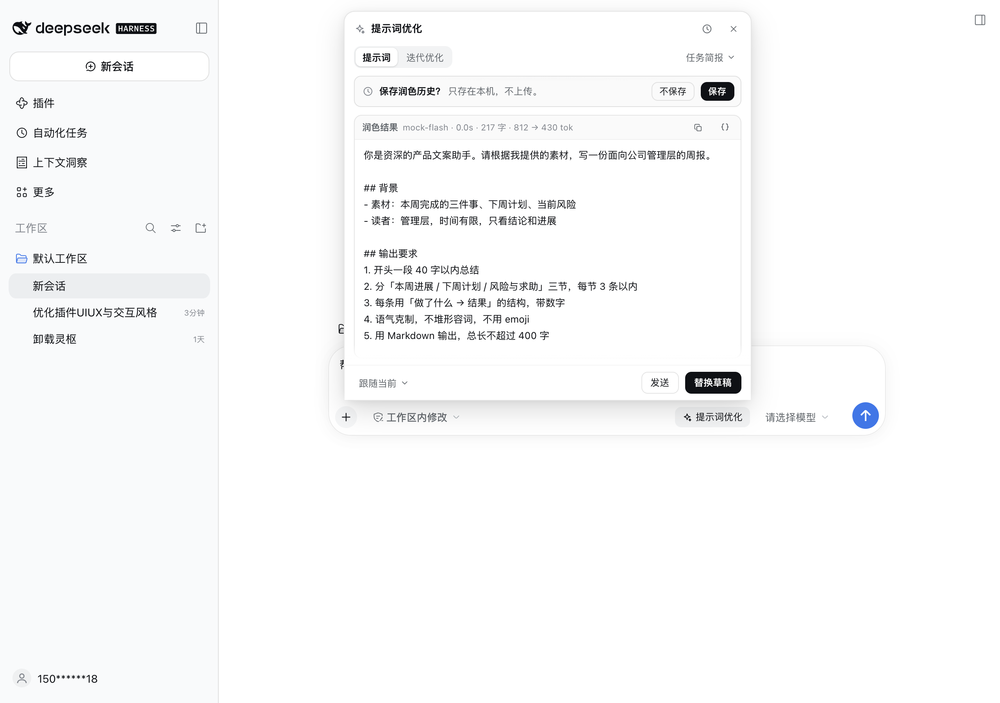
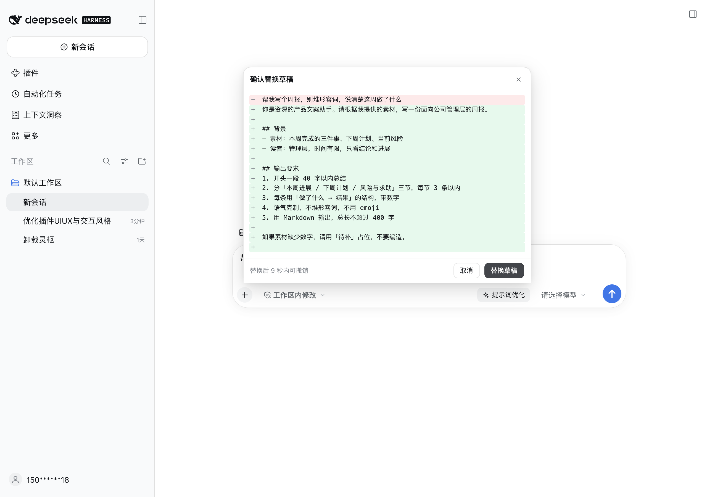
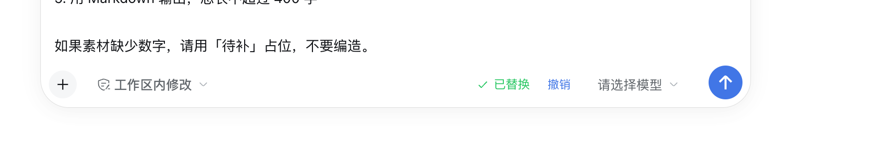
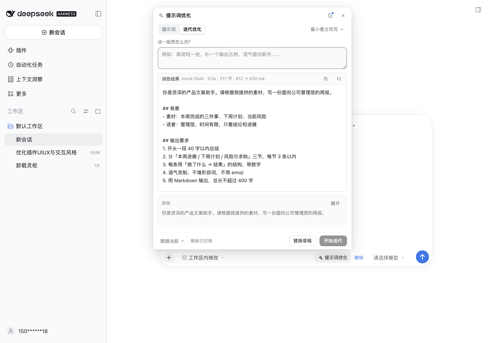
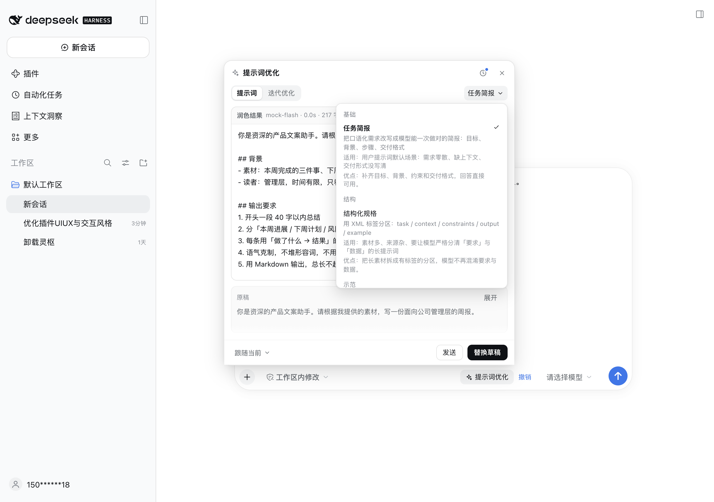
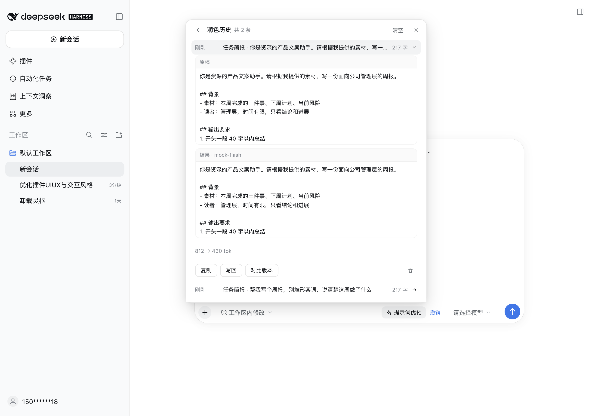
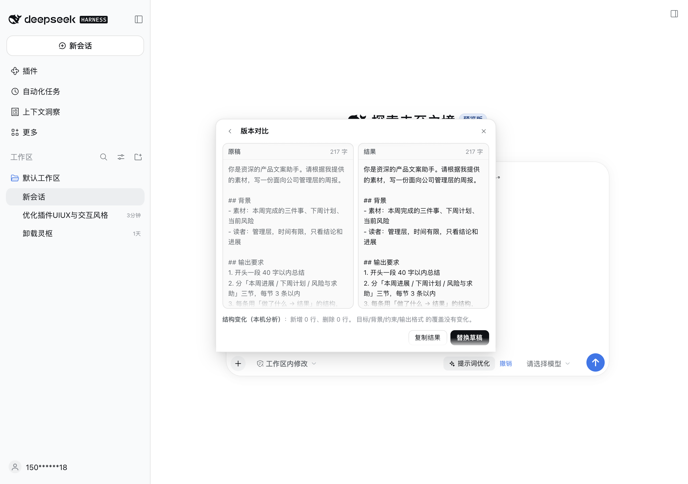
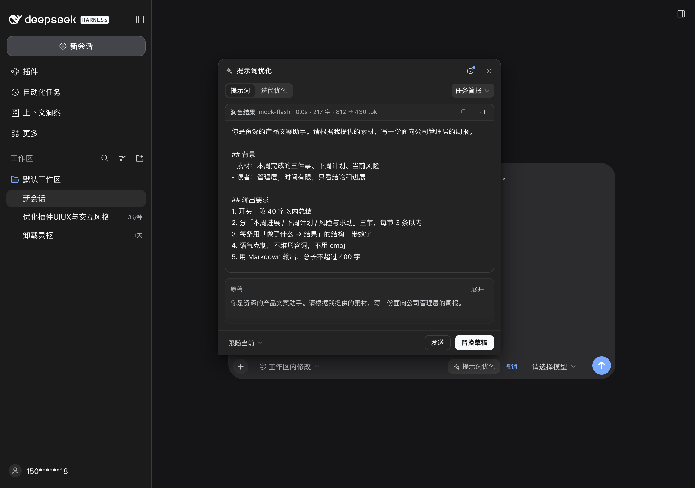

# dsh-prompt-polish

[简体中文](README.md) · [English](README_en.md)

[](https://github.com/Minus77/dsh-prompt-polish)
[](LICENSE)

给 [DeepSeek Harness](https://www.deepseek.com/harness/) 用的提示词优化器，长在输入框旁边。

多数人的输入框里躺着一句「帮我写个周报」，剩下的信息全靠模型猜。这个插件会在你按发送之前，把它改写成一份说清楚背景、交付形式和边界的提示词。入口就是输入框右下角那枚药丸，和原生 `选择模型` 同一副长相。



## 它做什么

打开面板，插件立刻用当前模式的默认模板跑一次，结果直接流出来。你可以把它发送出去，也可以先写回草稿再自己改几个字。

写回之前会先给一份逐行 diff：删了什么、加了什么，一眼能看完。确认之后才写进输入框，并且在 9 秒内留一个「撤销」的后悔药。草稿要是又被你动过，撤销按钮会自动收起来，免得把你刚敲的字覆盖掉。

模板切换和模型调用是分开的。换模板只是换个选择，底部会多出一个「用新模板重跑」，按了才真正发请求。这点很重要：模板挑来挑去的时候，不该每点一次就花一次钱。

## 安装

DeepSeek Harness `0.1.7` 及以上（在 `0.2.2-rc.1` 桌面版上验证过），Node.js 18 以上。插件没有构建步骤，`lib/*.js` 就是跑起来的那份代码。

从 npm 装：

```sh
dsh plugin --profile desktop add @minus77/dsh-prompt-polish
```

Web 版把 `desktop` 换成 `web`。

也可以直接从 GitHub 装：

```sh
dsh plugin --profile desktop add github:Minus77/dsh-prompt-polish
```

或者自己打包。仓库根有 `dsh.bundle` 清单，`npm pack` 会产出 `minus77-dsh-prompt-polish-<版本>.tgz`，把它交给 `dsh plugin add` 就行。

装完要重启一次 Harness。宿主侧的路由和模板目录在进程启动时加载，只重载窗口不够。

## 用法

### 点一下，然后等结果

在输入框里写草稿，点右下角的 `提示词优化`。面板贴在输入框上方打开，同时已经按默认模板跑了一次。

结果卡顶部写着模型、耗时、字数与 token 用量。底部只剩 `跟随当前`、`发送`、`替换草稿`，没有多余的「开始优化」按钮，因为打开的时候已经优化过了。


### 替换前先看 diff

点 `替换草稿` 先出对比，不是直接写入。删除的行红底，新增的行绿底，连续没改动的行折成一行说明。



确认后写进输入框。点 `取消` 或按 `Esc` 回到结果，草稿不动。

### 9 秒的后悔药

写入之后，入口药丸会变成 `✓ 已替换` 并多出一个 `撤销`。9 秒内点它，原文原样回来。



### 迭代

切到 `迭代优化`，写一句「这版还想怎么改」，点 `开始迭代`。模型拿着上一版结果做最小差分改写，新版接在版本链后面，可以逐版对比。



### 模板

模板菜单按分类分组，每一项带一句「这模板适合什么」和「适用 / 优点」。7 套模板都在注册表里，面板只露出和输入框草稿相关的 5 套。



| 模板 | 分类 | 什么时候用 |
| --- | --- | --- |
| `任务简报` `user-task` | 基础 | 需求零散、缺背景、没说交付形式 |
| `结构化规格` `user-spec` | 结构 | 素材多，需要分清「要求」与「数据」 |
| `示范驱动` `user-fewshot` | 示范 | 输出格式严格，描述容易走样 |
| `推理脚手架` `user-reason` | 推理 | 比较、判断、多步任务 |
| `最小差分` `iter-diff` | 迭代 | 拿着上一版提改进意见 |

`sys-role`（角色契约）和 `sys-soul`（Agent 人格文件）还在注册表里，旧 ID 与别名继续解析，只是从 0.5.0 起不在面板里出现。面板是围着输入框草稿设计的，系统提示词不属于它的场景。

### 变量提取

结果卡右上角的 `{ }` 把结果里可以变的片段抽成变量，这一步会调用一次模型。抽完得到一份带 `{{变量}}` 的模板，写回模板列表，以后填值就能复用。

### 历史与版本对比

授权保存之后，点头部的时钟图标进入历史。按时间倒序排列，展开能看原稿和结果，也能复制、写回、对比版本、删除。



同一条链上的版本可以在对比视图里切换。下面那段「结构变化」是本地算出来的：行数增删，目标、背景、约束、格式这几类信息覆盖了多少。整个对比过程不调用模型。



### 深色模式

颜色全部来自主题 token，深浅色自动适配，不需要单独配一套。



## 一些实现上的选择

界面是照着 Harness 自己的 composer 做的，几条约束直接写进了代码：

- 面板从 `conversation.input.right` 槽挂载，用 `createPortal` 定位到 `document.body`。composer 有 `container-type: inline-size`，不这样会被裁掉。
- 只用 `--dsw-alias-*` token，不写死颜色。层次靠 `color-mix(in srgb, var(--dsw-alias-label-primary) N%, transparent)` 叠出来。
- 控件 26 到 28 像素高，面板 520 像素宽，圆角 14。没有渐变、发光和呼吸动画。
- 「生成中」「已替换」「草稿已更新」这些状态都用文字说出来，不让颜色单独承担语义。

## 许可证

[GNU AGPL-3.0-or-later](LICENSE)

## 仓库结构

```text
dsh-prompt-polish/
├── LICENSE                  AGPL-3.0-or-later
├── README.md                本文件（中文）
├── README_en.md             英文说明
├── package.json             插件清单：exports / dsh.client.inject / bundle.patch
├── cordis.patch.yml         bundle 安装时插入的插件行
├── compat.mjs               对着本机 asar 的契约审计（16 项）
├── templates.test.mjs       模板注册表测试（11 项）
├── lib/
│   ├── index.js             宿主：/models、/optimize（NDJSON 流）、/extract-variables
│   ├── client.js            客户端：入口药丸、面板、diff、撤销、历史、对比、i18n
│   ├── prompts.js           模板注册表 + 别名 + 双语元数据
│   ├── processor.js         优化请求的组装与流式解析
│   ├── mustache.js          mustache 渲染（JSON helper / Set Delimiter）
│   └── extraction.js        变量提取与模板回填
└── docs/
    ├── TEMPLATES.md         模板体系：方法、骨架、变量规范、迁移映射
    ├── TEMPLATES.en.md      Template system (English)
    └── screenshots/         本文用图（中文 / en 各一套）
```
