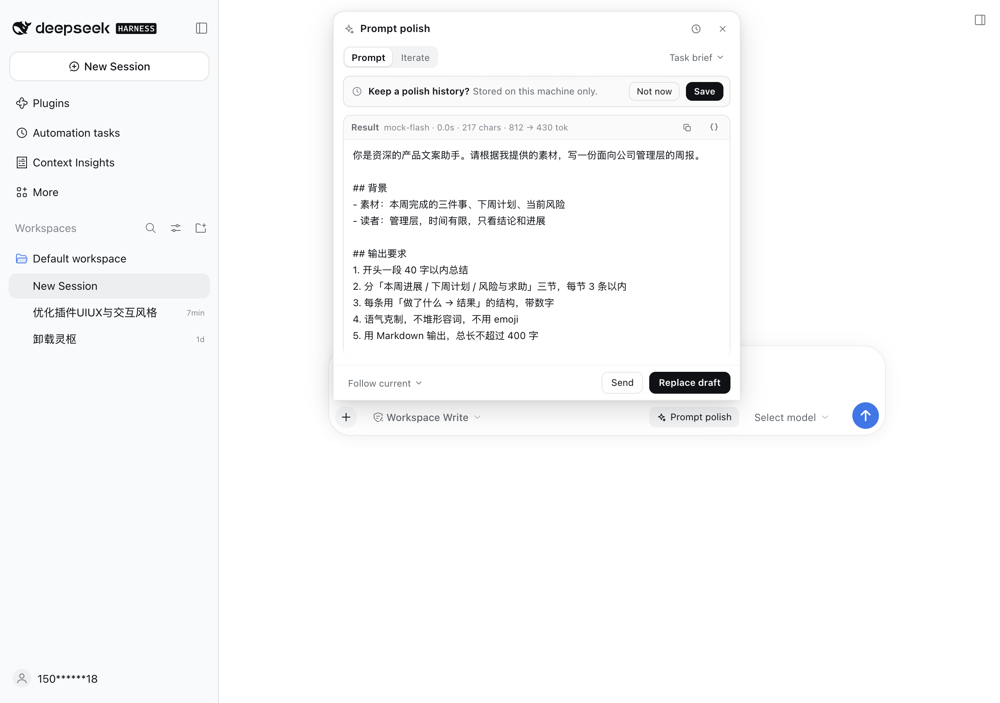
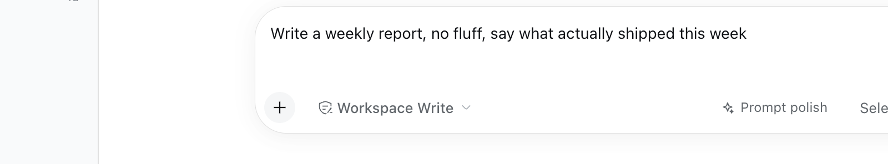
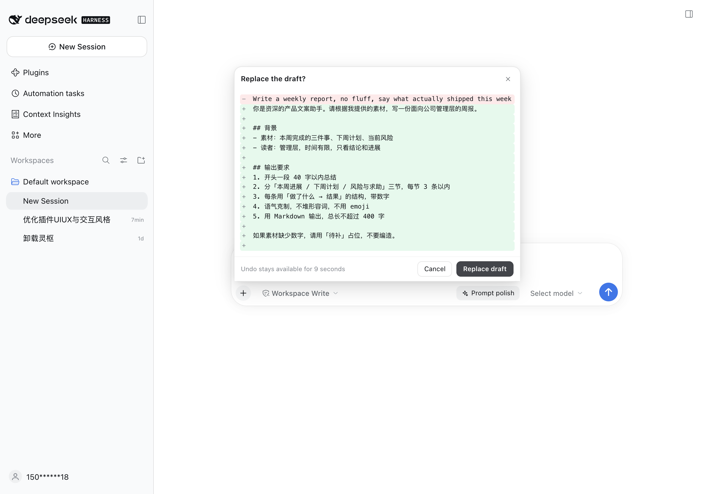
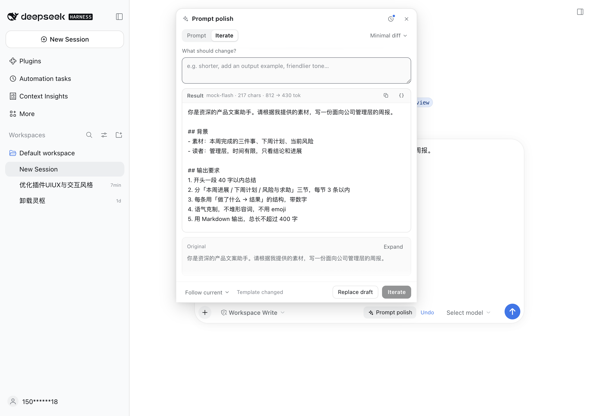
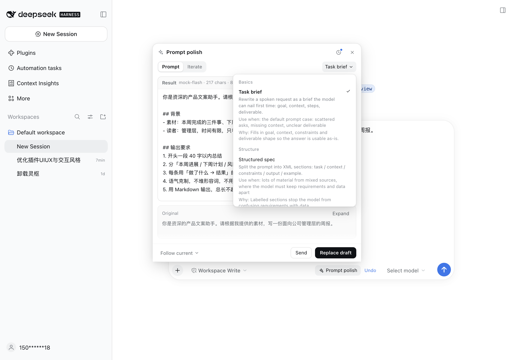
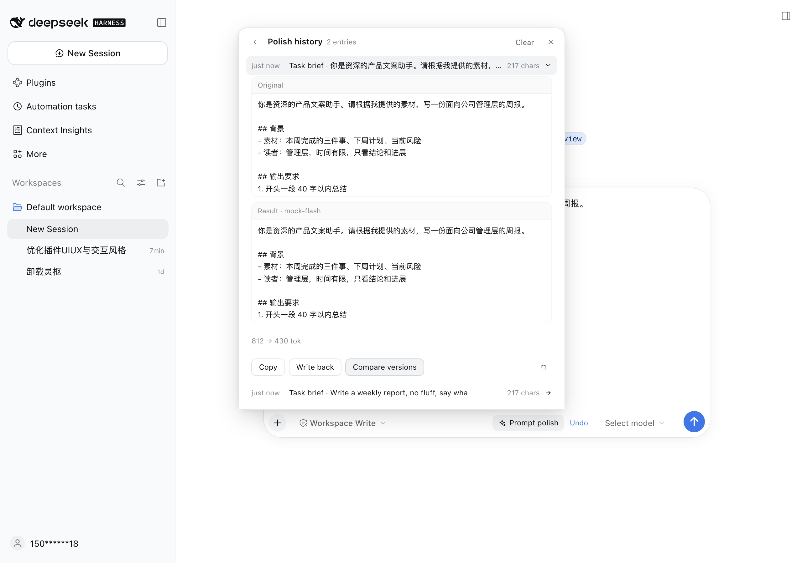
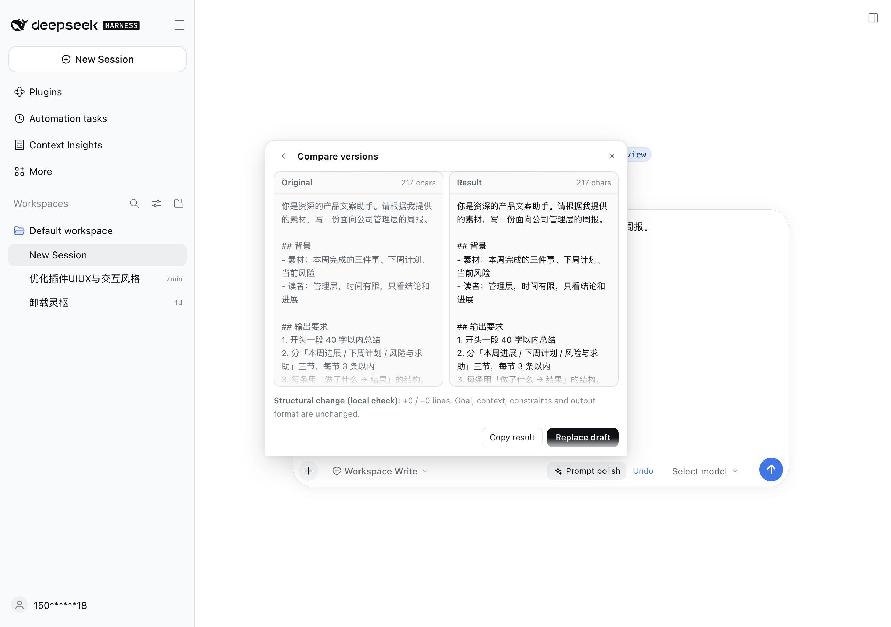
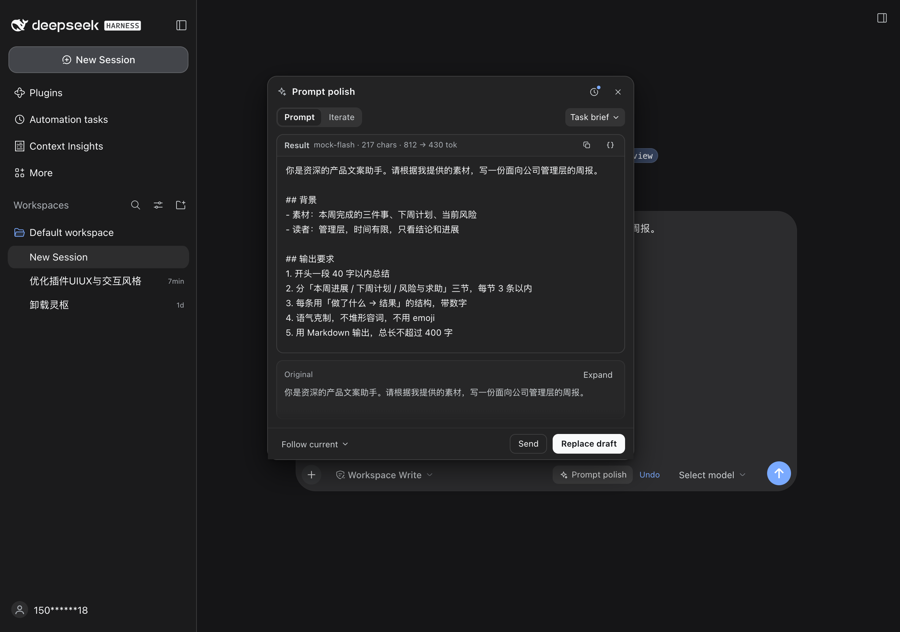

# dsh-prompt-polish

[简体中文](README.md) · [English](README_en.md)

[](https://github.com/Minus77/dsh-prompt-polish)
[](LICENSE)

**A prompt polisher that lives next to the composer — a plugin for [DeepSeek Harness](https://www.deepseek.com/harness/).**

Most drafts in a composer are one sentence long — "write my weekly report" — and the model has to guess the rest. This plugin rewrites that sentence into a prompt with clear edges before you hit send. The entry point sits in the composer's bottom-right corner, styled as the same plain-text pill as the native model picker.



## Contents

- [Overview](#overview)
- [Features](#features)
- [Install](#install)
- [Usage](#usage)
  - [It runs when you open it](#it-runs-when-you-open-it)
  - [Review the diff before replacing](#review-the-diff-before-replacing)
  - [Undo for nine seconds](#undo-for-nine-seconds)
  - [Iterate](#iterate)
  - [Templates](#templates)
  - [Variable extraction](#variable-extraction)
  - [History and version compare](#history-and-version-compare)
  - [Dark mode](#dark-mode)
- [Design constraints](#design-constraints)
- [Compatibility and limits](#compatibility-and-limits)
- [Development and tests](#development-and-tests)
- [License](#license)
- [Repository layout](#repository-layout)

## Overview

`dsh-prompt-polish` is not a prompt-generator website bolted onto the harness — it is part of the composer. It does three things and then stops and waits for you:

1. **Look before writing** — replacing a draft shows a line-by-line diff first; nothing is written until you confirm. After writing, the entry pill offers an undo for nine seconds.
2. **No surprise spending** — opening the panel runs one optimization; switching modes re-runs; switching templates only changes the selection, and you decide when to spend a call on it.
3. **Looks native** — every color comes from DSH theme tokens, light and dark both work; the overlay portals to `document.body` so the composer never clips it.

The engine is ported from [linshenkx/prompt-optimizer](https://github.com/linshenkx/prompt-optimizer) (optimization-mode axis, mustache template engine, variable extraction). The template set was rebuilt in 0.4.0 around verifiable prompt-construction methods — see [docs/TEMPLATES.en.md](docs/TEMPLATES.en.md).

## Features

| Capability | Behaviour |
| --- | --- |
| Entry | A plain-text pill (`Prompt polish`) in the composer's bottom-right corner, same shape as the native model seat — no glow, no gradient |
| Runs on open | Opening the panel immediately optimizes with the current mode's default template; an empty composer spends nothing |
| Mode switch | Aborts the live stream and re-runs with the new mode's default template; switches within 220 ms coalesce into one call |
| Template switch | Selection only — no request. A `Run with new template` button appears; nothing is spent until you press it |
| Same draft again | Closing and reopening reuses the result already on screen |
| Replace | Shows a line diff first (removed red, added green, unchanged lines collapsed), writes only after confirmation |
| Undo | For nine seconds after replacing, the entry pill offers `Undo` |
| Iterate | Takes the last result plus one sentence of feedback and applies a minimal diff; versions form a chain |
| Templates | Seven registered, five exposed in the panel (four prompt + one iterate), grouped as Basics / Structure / Examples / Reasoning / Iteration |
| Variables | The `{ }` action extracts variable parts into `{{name}}` placeholders and writes a reusable template back |
| Local history | Opt-in versions in `localStorage` (max 50), delete one, delete a chain, clear all |
| Compare | Original \| result columns, switch versions within a chain, plus a local structural analysis (line counts, goal/background/constraint/format coverage) that never calls a model |
| Model | Follows the composer's model by default; can be pinned to a provider/model |
| Usage | Model, duration, characters and tokens per run; shows "not reported" instead of a fake zero |
| Language | Follows the harness' `<html lang>` — Chinese or English, and switches live |
| Theme | Only `--dsw-alias-*` tokens; dark mode adapts automatically |

## Install

Requires DeepSeek Harness `>= 0.1.7` (verified on the `0.2.2-rc.1` desktop build) and Node.js `>= 18`. There is no build step: `lib/*.js` is the runtime.

### 1. Get the package

```sh
git clone https://github.com/Minus77/dsh-prompt-polish.git
cd dsh-prompt-polish
npm pack
```

This produces `benrong-dsh-prompt-polish-0.7.1.tgz` (the name follows the version).

### 2. Install it into a profile

```sh
dsh plugin --profile web add ./benrong-dsh-prompt-polish-0.7.1.tgz
```

For the desktop build use `--profile desktop`:

```sh
dsh plugin --profile desktop add ./benrong-dsh-prompt-polish-0.7.1.tgz
```

`dsh plugin` forwards everything to pnpm inside the profile directory, so local tarballs, directories and registry names all work.

### 3. Make it take effect

Host-side code (routes, template catalog) loads when the process starts, so restart DeepSeek Harness once after installing; client bundles refresh with the window afterwards.

> The package is **not published to npm**; `dsh plugin add @benrong/dsh-prompt-polish` would look for an unrelated public package and fail. Use the local tarball path.

## Usage

### It runs when you open it

Type a draft, then click `Prompt polish` in the composer's bottom-right corner. The panel opens above the composer and has already optimized with the default template (`Task brief`) — no extra button to press.



The result card header shows model, duration, characters and token usage; the footer keeps only `Follow current`, `Send` and `Replace draft` — there is no "Polish" button because opening already polished.

### Review the diff before replacing

`Replace draft` does not write immediately. It shows a line-by-line comparison first: removed lines on red, added lines on green, runs of unchanged lines collapsed into a single marker.



Only the confirmation writes to the composer; `Cancel` or `Esc` returns to the result.

### Undo for nine seconds

After writing, the entry pill becomes `✓ Replaced` and grows an `Undo` action. Clicking it restores the original draft; if you edit the draft first, the undo disappears so it cannot clobber new text.


### Iterate

Switch to `Iterate`, describe what should change, and press `Start iterate`. The model applies a minimal diff to the previous result, and that result becomes the next version in a chain you can compare.



### Templates

The template picker groups templates by category and each item explains what it does plus when it helps. Switching templates does not run anything — a `Run with new template` button appears, and the call happens only when you press it.



| Template | Category | Use it when |
| --- | --- | --- |
| `Task brief` `user-task` | Basics | the request is scattered, missing context, or silent about the deliverable |
| `Structured spec` `user-spec` | Structure | there is a lot of material and "requirements" must be separated from "data" |
| `Worked examples` `user-fewshot` | Examples | the output format is strict and prose descriptions drift |
| `Reasoning scaffold` `user-reason` | Reasoning | comparison, judgement, multi-step tasks |
| `Minimal diff` `iter-diff` | Iteration | you have a previous result plus a correction |

`sys-role` (role contract) and `sys-soul` (agent persona file) stay registered — old IDs and aliases still resolve — but they left the panel in 0.5.0: the panel is about composer drafts, and system prompts are not that job.

### Variable extraction

The `{ }` action in the result header turns the variable parts of a result into placeholders (this one call uses the model), writes a `{{name}}` template and puts it back into the template list, ready to reuse.

### History and version compare

After you allow saving, the clock icon opens history: versions newest first, expandable into original / result with copy, write-back, compare and delete.



Versions in the same chain can be switched inside the compare view, which adds a local structural analysis (line additions and removals, goal/background/constraint/format coverage) computed from local data only.



### Dark mode

Every color is a theme token, so dark mode flips automatically with no separate configuration.



## Design constraints

The UI is modelled on the harness' own composer, and a few constraints are baked into the code:

- **It grows out of the composer** — mounted in the `conversation.input.right` slot and positioned through `createPortal` onto `document.body`, so nothing can clip it.
- **Theme tokens only** — `--dsw-alias-bg-layer-1`, `border-l2`, `label-secondary`, `button-primary-fill`, and so on; layering uses `color-mix(in srgb, var(--dsw-alias-label-primary) N%, transparent)`.
- **Native sizes** — 26–28 px controls, a 520 px panel, 14 px corners; no gradients, glow or breathing animations.
- **States are words** — "Generating", "Replaced", "Draft updated" are text, never color alone.

## Compatibility and limits

- **Routes that need a session header** — the plugin forwards the current `sessionId` to `llm.stream`, so the host can inject `x-opencode-session`; without a session it uses a process-stable fallback id.
- **Streaming** — optimization uses an NDJSON stream rendered incrementally; closing the panel aborts the stream.
- **History stays local** — stored in `localStorage` (`dsh.prompt-polish/history`), off by default with a prompt after the first run, capped at 50 entries.
- **Line-level diff** — LCS per line; very large inputs (line product > 400000) degrade to "all removed, all added" instead of freezing the UI.
- **Template variables** — the existing `{{variable}}` placeholder format is preserved verbatim, including through variable extraction.
- **Bilingual** — follows `<html lang>`; both dictionaries ship in the bundle, so switching language needs no reinstall.

## Development and tests

```sh
node templates.test.mjs        # registry, variables, aliases, defaults (11 checks)
node compat.mjs --asar "/path/to/DeepSeek Harness.app/Contents/Resources/app.asar"
```

`compat.mjs` audits the plugin contract against the installed harness (module loader, slots, manifest, portal rule, injected package versions); it currently passes 16/16.

## License

[MIT](LICENSE)

## Repository layout

```text
dsh-prompt-polish/
├── LICENSE                 MIT
├── README.md               Chinese README
├── README_en.md            this file
├── package.json            manifest: exports / dsh.client.inject / bundle.patch
├── cordis.patch.yml        bundle row inserted on install
├── compat.mjs              contract audit against the local asar (16 checks)
├── templates.test.mjs      template registry tests (11 checks)
├── lib/
│   ├── index.js            host: /models, /optimize (NDJSON), /extract-variables
│   ├── client.js           client: pill, panel, diff, undo, history, compare, i18n
│   ├── prompts.js          template registry, aliases, bilingual metadata
│   ├── processor.js        request assembly and stream parsing
│   ├── mustache.js         mustache rendering (JSON helper / set delimiter)
│   └── extraction.js       variable extraction and template back-fill
└── docs/
    ├── TEMPLATES.md        template system (Chinese)
    ├── TEMPLATES.en.md     template system (this language)
    ├── menu-templates.png  older menu screenshot, kept for reference
    └── screenshots/        images used here (zh and en sets)
```
